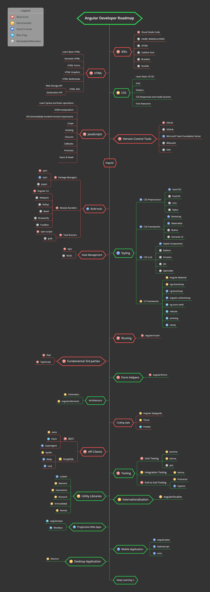

## Angular Developer Roadmap

> A practical, developer-focused **roadmap** to becoming an **Angular Developer** in 2026 — covering the essential tools, libraries, and concepts you need along the way.

Below you can find a chart demonstrating the paths that you can take and the libraries that you would want to learn to become an Angular developer. I made this chart as a tip for everyone who asks me, "What should I learn next as an Angular developer?"

## Disclaimer

> The purpose of this roadmap is to give you an idea about the landscape. The road map will guide you if you are confused about what to learn next, rather than encouraging you to pick what is hip and trendy. You should grow some understanding of why one tool would be better suited for some cases than the other and remember hip and trendy does not always mean best suited for the job

## Table of Contents

| No. | Topic                                                                  |
| --- | ---------------------------------------------------------------------- |
| 2   | [Roadmap](#2-roadmap)                                                  |
| 3   | [IDEs](#3-ides)                                                        |
| 4   | [HTML](#4-html)                                                        |
| 5   | [CSS](#5-css)                                                          |
| 6   | [JavaScript](#6-javascript)                                            |
| 7   | [Angular](#7-angular)                                                  |
| 8   | [Routing](#8-routing)                                                  |
| 9   | [Build Tools](#9-build-tools)                                          |
| 10  | [UI Design](#10-ui-design)                                             |
| 11  | [API Clients](#11-api-clients)                                         |
| 12  | [Fundamental 3rd Parties](#12-fundamental-3rd-parties)                 |
| 13  | [State Management](#13-state-management)                               |
| 14  | [Architecture](#14-architecture)                                       |
| 15  | [Coding Style](#15-coding-style)                                       |
| 16  | [Utility Libraries](#16-utility-libraries)                             |
| 17  | [Testing](#17-testing)                                                 |
| 18  | [Internationalization](#18-internationalization)                       |
| 19  | [Progressive Web Apps](#19-progressive-web-apps)                       |
| 20  | [Server-Side Rendering](#20-server-side-rendering)                     |
| 21  | [Mobile Application Development](#21-mobile-application-development)   |
| 22  | [Desktop Application Development](#22-desktop-application-development) |

## 2. Roadmap

    

**[⬆ Back to Top](#table-of-contents)**

## 3. IDEs

| IDE                                                          | Short Description                                   | Pricing      |
| ------------------------------------------------------------ | --------------------------------------------------- | ------------ |
| [Visual Studio Code](https://code.visualstudio.com/Download) | Lightweight and highly extensible code editor.      | **Free**     |
| [WebStorm](https://www.jetbrains.com/webstorm/)              | Powerful IDE for modern JavaScript development.     | **Paid**     |
| [Bolt](https://bolt.new/)                                    | AI-powered tool for building web applications.      | **Freemium** |
| [Cursor](https://www.cursor.com/)                            | AI-powered code editor with smart assistance.       | **Freemium** |
| [Sublime Text](https://www.sublimetext.com/)                 | Fast and customizable lightweight editor.           | **Paid**     |
| [Atom](https://atom.io/)                                     | Open-source and highly customizable code editor.    | **Free**     |
| [Brackets](http://brackets.io/)                              | Frontend-focused editor with live preview.          | **Free**     |
| [Eclipse](https://www.eclipse.org/)                          | Extensible IDE for Java and enterprise development. | **Free**     |

**[⬆ Back to Top](#table-of-contents)**

## 4. HTML

- [w3schools](https://www.w3schools.com/html/) HTML Tutorial
- [MDN Web Docs](https://developer.mozilla.org/en-US/docs/Web/HTML) HTML: HyperText Markup Language

**[⬆ Back to Top](#table-of-contents)**

## 5. CSS

- [w3schools](https://www.w3schools.com/css/) CSS Tutorial
- [MDN Web Docs](https://developer.mozilla.org/en-US/docs/Web/CSS) CSS: Cascading Style Sheets
- [fontawesome](https://fontawesome.com/) Official website
- [w3schools](https://www.w3schools.com/icons/icons_reference.asp) Icons Reference

**[⬆ Back to Top](#table-of-contents)**

## 6. JavaScript

_Basic_

- [w3schools](https://www.w3schools.com/js/default.asp) JavaScript Tutorial
- [developer.mozilla](https://developer.mozilla.org/en-US/docs/Web/JavaScript) JavaScript
- [javascript.info](https://javascript.info/) The Modern JavaScript Tutorial
- [htmlcheatsheet](https://htmlcheatsheet.com/js/) JS CheatSheet

_ES6_

- [exploringjs](https://exploringjs.com/es6/index.html) Exploring ES6
- [compat-table](https://compat-table.github.io/compat-table/es6/) ECMAScript 6 compatibility table
- [babeljs](https://babeljs.io/docs/en/learn) Learn ES2015
- [github](https://github.com/lukehoban/es6features) ECMAScript 6
- [github](https://github.com/sudheerj/ECMAScript-features) ECMAScript 6

_Style Guide_

- [github](https://github.com/airbnb/javascript) Airbnb JavaScript Style Guide
- [github](https://github.com/ryanmcdermott/clean-code-javascript) clean-code-javascript

_Playground_

- [js-array-playground](https://js-array-playground.firebaseapp.com/) JavaScript Array Playground
- [jsfiddle](https://jsfiddle.net/)
- [plnkr](https://plnkr.co/)
- [jsbin](https://jsbin.com/?html,output)
- [codepen](https://codepen.io/pen/)
- [stackblitz](https://stackblitz.com/)

**[⬆ Back to Top](#table-of-contents)**

## 7. Angular

- [Official website](https://angular.dev/)

**[⬆ Back to Top](#table-of-contents)**

## 8. Routing

- [Angular Router](https://angular.dev/guide/routing)

**[⬆ Back to Top](#table-of-contents)**

## 9. Build Tools

- Package Managers
  - [npm](https://www.npmjs.com/)
  - [yarn](https://yarnpkg.com/)
  - [pnpm](https://pnpm.io/)
- Module Bundlers
  - [angular-cli](https://angular.dev/cli)
  - [Webpack](https://webpack.js.org/)
  - [esbuild](https://esbuild.github.io/)
  - [Vite](https://vitejs.dev/)
  - [Bazel](https://bazel.build/)
  - [Rollup](https://rollupjs.org/)
- Task Runners
  - [npm scripts](https://docs.npmjs.com/misc/scripts)
  - [gulp](https://gulpjs.com/)
  - [grunt](https://gruntjs.com/)

**[⬆ Back to Top](#table-of-contents)**

## 10. UI Design

- CSS Preprocessor
  - [Sass/CSS](https://sass-lang.com/)
  - [PostCSS](https://postcss.org/)
  - [Less](http://lesscss.org/)
  - [Stylus](http://stylus-lang.com/)
- CSS Frameworks
  - [Bootstrap](https://getbootstrap.com/)
  - [Materialize](https://materializecss.com/)
  - [Bulma](https://bulma.io/)
  - [Semantic UI](https://semantic-ui.com/)
- CSS in JS
  - [Styled Components](https://www.styled-components.com/)
  - [Radium](https://formidable.com/open-source/radium/)
  - [Emotion](https://emotion.sh/)
  - [JSS](http://cssinjs.org/)
  - [Aphrodite](https://github.com/Khan/aphrodite)
- UI Frameworks
  - [Angular Material](https://material.angular.io/) - Material Design components for Angular
  - [ngx-bootstrap](https://github.com/valor-software/ngx-bootstrap) Bootstrap widgets in Angular
  - [ng-bootstrap](https://github.com/ng-bootstrap/ng-bootstrap) Angular powered Bootstrap
  - [ng-zorro-antd](https://ng.ant.design/docs/introduce/en) Angular UI component library based on Ant Design
  - [nebular](https://github.com/akveo/nebular) Angular UI Library based on Eva Design System
  - [PrimeNG](https://github.com/primefaces/primeng) Angular UI Component Library
  - [Clarity](https://clarity.design/) Angular components working together to craft exceptional experiences

**[⬆ Back to Top](#table-of-contents)**

## 11. API Clients

- REST
  - [Fetch](https://developer.mozilla.org/en-US/docs/Web/API/Fetch_API)
  - [SuperAgent](https://visionmedia.github.io/superagent/)
  - [axios](https://github.com/axios/axios)
- GraphQL
  - [Apollo](https://apollo-angular.com/docs/)
  - [Relay](https://facebook.github.io/relay/)
  - [urql](https://github.com/FormidableLabs/urql)

**[⬆ Back to Top](#table-of-contents)**

## 12. Fundamental 3rd Parties

- TypeScript
  - ["TypeScript Deep Dive"](https://github.com/basarat/typescript-book)
  - [Typescript Docs](https://www.typescriptlang.org/docs/)
- RxJS
  - [The introduction to Reactive Programming](https://gist.github.com/staltz/868e7e9bc2a7b8c1f754)
  - [RxJS manual](https://rxjs.dev/guide/overview)
  - [RxJS In-Depth (video)](https://www.youtube.com/watch?v=KOOT7BArVHQ)

**[⬆ Back to Top](#table-of-contents)**

## 13. State Management

- [Signals (built-in)](https://angular.dev/guide/signals)
- [ngrx](https://ngrx.io/)
- [NGXS](https://www.ngxs.io/)

**[⬆ Back to Top](#table-of-contents)**

## 14. Architecture

- [Schematics](https://www.npmjs.com/package/@angular-devkit/schematics)
- [angular/elements](https://angular.dev/guide/elements)

**[⬆ Back to Top](#table-of-contents)**

## 15. Coding Style

- [Angular Styleguide](https://angular.dev/styleguide)
- [ESLint](https://eslint.org/) with [typescript-eslint](https://typescript-eslint.io/) (replaces the deprecated TSLint)
- [Prettier](https://prettier.io/)

**[⬆ Back to Top](#table-of-contents)**

## 16. Utility Libraries

- [Lodash](https://lodash.com/)
- [Moment](https://momentjs.com/) (maintenance mode – consider [date-fns](https://date-fns.org/), [Day.js](https://day.js.org/), or [Luxon](https://moment.github.io/luxon/))
- [classnames](https://github.com/JedWatson/classnames)
- [Numeral](http://numeraljs.com/)
- [ImmutableJS](https://facebook.github.io/immutable-js/)
- [Ramda](https://ramdajs.com/)

**[⬆ Back to Top](#table-of-contents)**

## 17. Testing

- Unit Testing
  - [Jasmine](https://jasmine.github.io/)
  - [Jest](https://jestjs.io/)
  - [Vitest](https://vitest.dev/)
- E2E Testing
  - [Cypress](https://www.cypress.io/)
  - [Playwright](https://playwright.dev/)

> Note: [Karma](https://karma-runner.github.io/) and [Protractor](https://www.protractortest.org/#/) are deprecated. Protractor reached end-of-life in August 2023 — prefer Cypress or Playwright for E2E testing.

**[⬆ Back to Top](#table-of-contents)**

## 18. Internationalization

- [angular/localize](https://angular.dev/guide/i18n)

**[⬆ Back to Top](#table-of-contents)**

## 19. Progressive Web Apps

- [angular/pwa](https://angular.dev/ecosystem/service-workers/getting-started)
- [Workbox](https://developer.chrome.com/docs/workbox/)

**[⬆ Back to Top](#table-of-contents)**

## 20. Server-Side Rendering

- [@angular/ssr](https://angular.dev/guide/ssr) - built-in SSR/SSG with hydration (successor of Angular Universal)

**[⬆ Back to Top](#table-of-contents)**

## 21. Mobile Application Development

- [NativeScript](https://www.nativescript.org/)
- [Ionic](https://ionicframework.com/)

**[⬆ Back to Top](#table-of-contents)**

## 22. Desktop Application Development

- [Electron](https://electronjs.org/)

**[⬆ Back to Top](#table-of-contents)**

## Author

**Md. Saiful Islam**
_Microsoft Certified Solutions Developer (MCSD) – Programming in C#_

**GitHub:** [@saifaustcse](https://github.com/saifaustcse)
**LinkedIn:** [Md. Saiful Islam](https://www.linkedin.com/in/saif-aust-cse/)

If you find this roadmap useful, please give :star:. Your support is appreciated!
